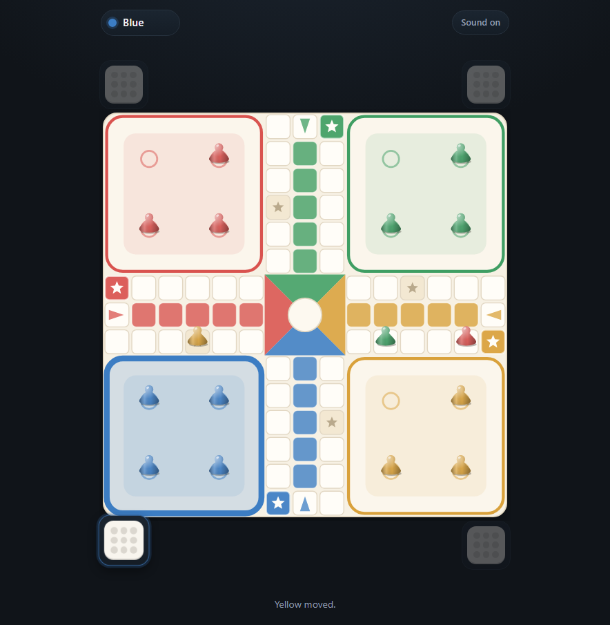

# Ludo Offline

Classic Ludo for one device. No ads, no accounts, no network calls, no install.

**[▶ Play now](https://surajak.github.io/LudoGame/)**



## Why this one

- **Hotseat Ludo, 2–4 players.** Pass the phone, take turns. No sign-up, nothing tracked.
- **No ads, no IAP, no servers.** The whole game is one HTML file with zero external requests.
- **Honest rules.** Sixes, captures, blockades, safe squares, exact roll to finish — each one has a unit test.
- **Own art and audio.** Pawns are drawn as vectors on a canvas; dice, steps and captures are synthesised with WebAudio. No borrowed assets, no audio files.
- **Constant hop speed.** A pawn crosses one square per beat, so a six visibly takes six times as long as a one.
- **Readable board.** Every legal move gets a hopping preview; the die of the seat to play keeps bouncing until rolled.

## How to play

0. Use **Play 2 players** / **Play 4 players** in the header to pick the mode. Two players sit on opposite corners. Switching starts a new game.
1. Tap the die beside **your** home to roll. `Space` or `Enter` also roll.
2. Roll a **6** to bring a pawn out of the yard.
3. Tap one of the bouncing, enlarged pawns to move it. When only one move is legal, it plays itself.
4. First player with all four pawns home wins.

| Rule | Behaviour |
|---|---|
| Enter the board | on a 6 only |
| Roll a 6 | roll again |
| Three 6s in a row | turn forfeited |
| Capture | opponent pawn returns to its yard, and you roll again |
| Safe squares | four starts + four stars: no captures there |
| Blockade | two or more pawns of one colour block landing, not passing |
| Home column | 5 cells; an exact roll is required |
| No legal move | turn passes automatically |

## Run it locally

```sh
cd web
npm install
npm run dev        # http://localhost:5173
```

Playing from your phone on the same Wi-Fi:

```sh
npm run dev:lan    # then open http://<your-PC-LAN-IP>:5183/
```

## Build one shareable file

```sh
cd web
npm run bundle     # writes dist/ludo.html, ~26 kB, everything inlined
```

Send that single file to anyone. They double-click it and play — offline, no server, no install. The deployed GitHub Pages site is built from that same file.

## Project structure

```
web/src/engine/    rules: board geometry, PRNG, state, legal moves, turn flow
web/src/render/    canvas board, pawn art, hop animation
web/src/audio/     WebAudio cues (no audio files)
web/src/main.ts    app shell: sizing, hit testing, dice rails, HUD
web/tests/         engine, motion and 2,000-game fuzz tests
web/scripts/       single-file bundler, headless-Chrome UI smoke test
docs/              feature spec, build/recon notes
```

## Tests

```sh
cd web
npm test           # rules, motion, determinism
npm run test:fuzz  # 2,000 random games: always terminate, invariants hold
node scripts/ui-smoke.mjs   # drives real Chrome, clicks real pawns, checks layout
```

The engine is deterministic: a seed plus a list of actions reproduces a game byte for byte, so every bug is reproducible.

## Tech

TypeScript and HTML5 Canvas with no runtime dependencies. `vite` and `typescript` are dev-only. Motion is skipped when the OS requests reduced motion; sound starts after your first tap, as browsers require.

More detail in [`web/README.md`](web/README.md) and [`docs/feature-spec.md`](docs/feature-spec.md).
